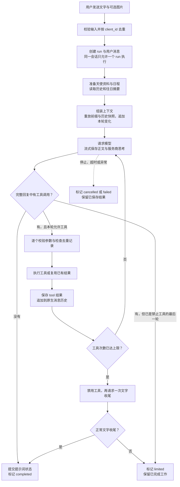
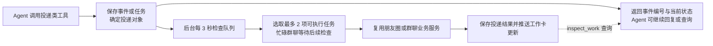

# 神说 Agent 流程与设计思路

基于 2026-11-03 的实现。神说让天使既能自然聊天，也能调用邻舍现有功能完成用户要求。核心是一个原生工具调用循环：**模型决定下一步，工具执行真实操作，结果回到模型，模型继续判断或回复。**

## 主流程

这里的 `run` 是用户发来一条消息后的一次完整回应，其中可以包含多轮模型请求。

默认最多 **8 轮模型请求、16 次工具调用**，第 8 轮不再提供工具；工具额度用完时也会安排纯文本收尾。一次模型返回的多个工具按顺序执行，成功和失败结果都会交给下一轮模型。只有完整接收并通过协议校验的工具请求才会进入执行，流式参数尚未收齐时不会提前行动。

停止、超时或异常也可能发生在准备和工具阶段，统一由外层捕获。单次回应设有 10 分钟超时；停止会阻止后续调用，并取消本轮尚未开始的神谕投递，已经提交的业务结果不会回滚。

消息、正文增量、思考增量、工具状态和结束事件持续落库。前端通过 SSE 接收这些记录，刷新后先读取快照，再按事件游标续接。**重连恢复的是展示，不会重新执行一遍 Agent。**

## 后台投递流程

发朋友圈、群聊讨论和世界事件引发的反应由独立队列处理，因此模型回复结束不等于业务全部完成。

世界事实在创建时生效，角色反应随后投递；默认感知范围和实际参与发帖、讨论的对象分别管理。队列失败后只重试明确失败的投递，已成功结果保留，结果不确定的任务先核对。

## 设计思路

### 把决策循环保持在最小范围

`agent.js` 只接收 `prepare`、`stream`、`tools`、`repo` 和取消信号，负责请求模型、执行工具、回填结果与结束。天使人格、会话、记忆、业务队列由外部模块负责。日常聊天可以直接结束，复杂要求则由模型根据实际结果逐步选择工具，无需为每种需求预先编排流程。

### 工具复用现有业务入口

核心工具负责查角色、改日程、创建奇遇和世界事件等；模块工具通过固定能力目录映射到既有 `/api/` 路由，沿用原模块的校验、库存、冷却和后台任务机制。模型只能选择已注册工具及其参数，不能自行指定 URL、SQL 或脚本。

模型负责理解意图、查清对象和解释结果，业务代码负责真正执行与校验。提示词要求明确区分“已安排”“已排队”“奇遇已开启”和“实际完成”，对外回复以工具返回的事实为依据。奇遇仍由用户在奇遇页选择推进。

### 上下文保持稳定并逐轮追加

首次请求按基础规则与世界观、Agent 规则、天使人格、用户资料和对话规则组织前缀，再加入往日摘要与本次会话。当前时间、日程、服装、世界事件和任务状态放在动态部分。

`promptState.js` 保存会话前缀和每条用户消息的最终请求片段，后续重放原片段并追加新内容。未变化的日程和状态不重复发送；资料、预设或状态改变时追加更新，不回写已发送历史，以维持前缀缓存和历史语义。世界书与预设通过现有叙事提示词入口接入。

`assistant.tool_calls`、`tool_call_id` 和服务商附加字段保留原生结构，避免把工具调用压成普通聊天文字后丢失关联。当前会话历史完整累积，仅过滤未完成消息和不完整工具批次；往日默认带入最近两次已完成摘要，更早内容通过 `recall_memory` 按需查询。跨日归档在循环外生成摘要和长期记忆。

### 用执行记录处理重复与中断

用户发送通过 `client_id` 去重；写工具以当前 `run`、工具名和规范化参数生成操作键，相同操作在同一次回应中复用已有记录。只读查询不按参数去重，以便再次读取最新状态。这个机制不代表跨所有对话的全局去重，也不等于业务操作可以自动回滚。

服务重启后，未结束的回应标为 `interrupted`，工具记录根据已保存结果恢复为 `done` 或 `uncertain`。后台投递另行核对业务记录，避免重复发布。写请求超时或断线时，业务可能已经提交，因此保留“结果待核对”，不直接重放。

## 代码入口

后端服务文件位于 `agent-core/src/services/godSays/`。

| 职责 | 文件 |
| --- | --- |
| 最小工具循环与退出条件 | [agent.js](../agent-core/src/services/godSays/agent.js) |
| 依赖组装、请求准备、启动与停止、定时维护 | [runtime.js](../agent-core/src/services/godSays/runtime.js) |
| 上下文分层、请求快照和状态增量 | [promptBuilder.js](../agent-core/src/services/godSays/promptBuilder.js)、[promptState.js](../agent-core/src/services/godSays/promptState.js)、[contextUpdates.js](../agent-core/src/services/godSays/contextUpdates.js) |
| 工具定义、校验、去重和业务调用 | [tools.js](../agent-core/src/services/godSays/tools.js)、[moduleTools.js](../agent-core/src/services/godSays/moduleTools.js)、[localApi.js](../agent-core/src/services/godSays/localApi.js) |
| 会话、消息、执行记录和 SSE 事件存储 | [repository.js](../agent-core/src/services/godSays/repository.js) |
| 世界事实、投递队列与恢复 | [worldEvents.js](../agent-core/src/services/godSays/worldEvents.js) |
| 当日历史、往日摘要与记忆检索 | [memory.js](../agent-core/src/services/godSays/memory.js) |
| 模型原生工具流适配 | [agentStream.js](../agent-core/src/llm/agentStream.js) |
| HTTP 与前端续接 | [routes/godSays.js](../agent-core/src/routes/godSays.js)、[stores/godSays.js](../web-ui/src/stores/godSays.js) |

功能细节见[神说模块说明](god-says.md)。扩展已有模块能力时，优先补充工具定义及业务映射；主循环继续只处理通用的调用和结果。当前会话完整累积有利于上下文连贯，但也会持续增加请求长度，轮数和工具额度限制并不能代替上下文长度管理。
