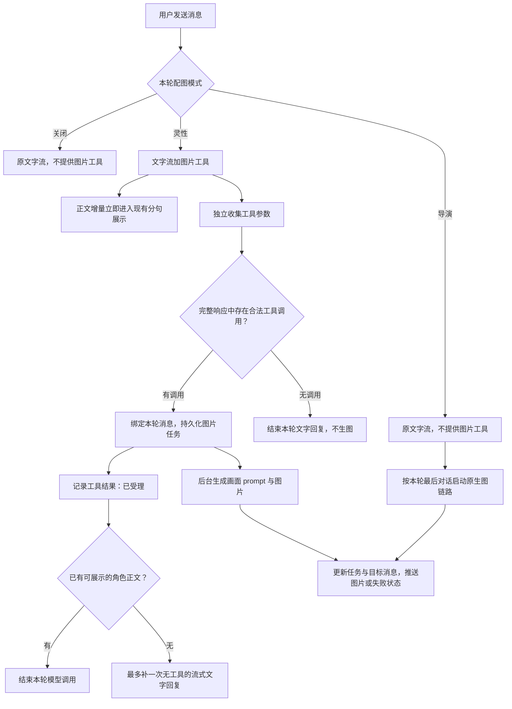

# 私聊图片工具接入计划

状态：代码已实施；2026-11-04 完成当前配置的真实 DeepSeek / ComfyUI 试用、修复后复测与普通聊天/Galgame、多端主题验收。

普通角色私聊的灵性配图改为原生工具调用：角色自主决定是否发图及画面内容，聊天正文继续流式展示，图片后台生成后追加。关闭配图不提供工具；强制配图更名为「导演模式」，继续由程序强制触发原生图链路。同时完整下线设置页的「深度思考（测试版）」及私聊预规划链路，工具接入后不再保留独立的媒介规划步骤。

实施记录（2026-11-03）：

- `privateChatImageTools.js` 承载唯一图片工具、参数校验、原生结果配对、一次无工具续写与任务幂等受理；共用消息文本函数迁至 `chatMessageText.js`。
- 新增 `private_chat_image_turns` 与 `private_chat_tool_calls`，保存用户原消息、固定图片载体、原生 assistant、调用参数、受理结果与上下文快照；图片仍走现有 `image_tasks`，服务重启沿用中断任务失败标记。
- 冻结画面描述请求、角色/交叉角色资料、LoRA 与主要生图设置；通过统一 SSE 的 `private_chat_image` 更新任务，读取消息时恢复未完成/失败任务。辅助猜想与情绪结果也不再阻塞文字流结束。
- 删除预规划器及其设置、请求字段、流事件、展示组件和新思考记录写入，保留历史 `thinking` 列；普通私聊、Galgame、小镇角色私聊调用参数已同步。
- 验证：后端 `npm test` 1227 通过、4 跳过；前端 `npm test` 598 通过、2 跳过。新增工具与任务测试、更新画面来源及 Galgame 回归；前端生产构建通过（沿用已有大 chunk 提示）。最终画面来源清理及失败任务测试另行复跑通过。
- 上述为 11 月 3 日的初始验证记录；11 月 4 日实测结果与修复见文末。NovelAI 和其他模型渠道未做真实出图，本轮使用用户当前的 DeepSeek 与本地 ComfyUI。

## 一 三种模式的行为

| 界面名称 | 内部值 | 主聊天请求 | 图片触发方式 |
| --- | --- | --- | --- |
| 灵性配图 | `smart` | 提供唯一的图片工具，`tool_choice: auto` | 角色调用才生图，不调用就不生图 |
| 关闭配图 | `off` | 不传图片工具及其选择配置 | 本轮不创建聊天配图任务 |
| 导演模式 | `force` | 不传图片工具及其选择配置 | 程序强制按本轮最后对话触发现有生图流程 |

保留 `off / smart / force` 的接口值、设置存储和旧 `force_image_gen` 兼容入口，避免因改名迁移用户偏好。现有模式切换位置、顺序和视觉样式沿用，只更新「强制配图」的显示名与相关说明。

「最后一句话」按现有 `buildImagePromptMessages` 的口径落地：以最新用户输入及对应角色回复组成的最后一轮对话为画面任务来源，历史仅供参考，不改为截取最后一个标点句。随着深度思考预规划链路删除，原先 planner 画面优先的分支一并消失；导演模式统一以最后一轮对话为准，保留其余生图处理。

## 二 工具与流式交互

首版只注册 `request_chat_image`，参数只收本次想展示的画面，不收聊天正文或最终技术 prompt：

```json
{
  "image_source": "camera",
  "include_self": false,
  "scene": "展示刚烤好的饼干，掰开一块露出内馅，背景为厨房操作台"
}
```

三个字段全部必填，禁止额外参数。`image_source` 为 `selfie / camera / album / saved`，分别表示当场自拍、后置拍摄、相册旧照、收藏图；`include_self` 为是否本人入镜的布尔值，自拍必须为 true。`scene` 为 1–2000 字符的角色第一人称分享意图与画面需求，保留紧邻对话确定的衣着、颜色、道具和动作。当前角色、会话、回复消息、有效外观和生图配置由服务端绑定，模型不能传入别的会话编号。工具说明提供完整参数示例和约束，但不要求聊天正文改成 JSON。

工具成功受理后立即返回，例如：

```json
{
  "ok": true,
  "status": "queued",
  "task_id": 123
}
```

只有任务持久化并成功交给后台执行后才返回受理成功。此结果不表示图片已经生成，也不包含编造的图片地址。



处理约定：

- `delta.content` 继续进入原有 `SentenceSplitter`、表情包解析和 `token` 推送，不等待工具参数或图片生成；不额外缓冲整段正文。
- `delta.tool_calls` 只在后台累积。完整响应结束、参数校验通过后才执行，不对半截 JSON 或异常截断的工具请求生图。
- 提示角色优先自然说话，再按需调用图片工具；协议不保证文字一定先到，不能承诺与纯文本完全相同的首字时间。
- 已有正文时不为“总结工具结果”增加模型请求；仅有工具调用时，回传真实受理结果，再补一次无工具的角色回复。失败结果也如实回传，不自动再发起生图。实测渠道偶尔在续写正文中泄漏 DSML 工具协议：在尚无可见正文时允许再做一次纯文字格式修复，不重新受理图片；已输出正文则保留正文并走异常处理。
- 每条用户消息最多受理一次图片任务。重复调用复用记录；不同的额外调用返回额度错误，每个调用都有对应结果。首版不提供自主重试、多图规划或图片审阅循环。

## 三 生图执行与消息生命周期

继续复用现有画面描述助手、`characterPersona`、交叉人物参考、画风、LoRA、ComfyUI／NovelAI 和图片保存逻辑。工具只替换画面需求来源，生图助手负责将 `scene` 转成最终 prompt；首版不让主聊天同时承担完整的生图规范。

需要把“按最后对话”和“按工具画面需求”做成明确的来源参数，避免借用 planner 名称后产生语义混乱：灵性以工具 `scene` 为本次画面任务，最后对话供语境参考；导演继续以最后对话为任务来源。新增请求遵循 [世界书插槽约定](lorebook-adaptation.md#新提示词的插槽约定)，保持稳定规则在前、动态材料在后。

图片任务必须在受理时冻结本轮输入、画面需求和角色资料等必要上下文，并绑定准确的用户原消息、角色回复和任务 ID。禁止后台执行时用「当前最新一条消息」寻找挂图位置，防止下一轮聊天到来后画面跑题或图片挂错回复。纯工具响应没有正文气泡时，通过本轮稳定锚点承接图片，补充文字不重复创建任务。

现有私聊虽然先展示文字，HTTP 流尾部仍会等待 `imageGenPromise`。接入时要拆开文字结束与图片任务结束：文字结束即可恢复输入，图片完成通过既有后台任务通知能力或补充的统一推送更新。保留 `generate_start / generate_progress / generate_done / generate_error` 的业务语义，不能仅把 Promise 不等待就视为完成异步改造。

关闭页面、切换角色或发送下一条消息不应取消已受理图片任务。刷新后从任务记录恢复状态；重启后对未完成任务核对并标记状态，不盲目重新生图。停止尚在输出的聊天会阻止未受理工具继续执行，已受理图片沿用独立任务生命周期，不把停止文字等同于回滚图片。

## 四 主聊天与现有能力的衔接

### 灵性模式只保留一个生图决策入口

在 `smart` 下停用独立 `judgeImageNeed`、图片意图正则直接触发、计数器强制配图、`<needImage>` 和内嵌 prompt 的生图触发。用户提出发图要求仍由角色结合上下文决定是否调用工具，不再由隐藏兜底强制执行。旧标记的显示清理可保留，但不产生副作用。模式以请求开始时的值为准，切换模式只影响后续消息。

### 完整移除深度思考测试版

删除「先规划文字／表情／图片，再生成正式回复」这一私聊功能，不仅隐藏设置开关。普通聊天和表情包继续由主回复模型直接输出，灵性配图由图片工具决定，导演模式由程序触发，不再增加前置 planner 请求。

清理范围：

- 设置与配置：删除 `SettingsView.vue` 的「深度思考（测试版）」设置行及处理函数，删除前端 settings store 中的 `deepThinkMode / setDeepThinkMode`、后端默认配置、seed 和 settings 映射。旧数据库即使保留 `feature_deepThinkMode=true`，也不得再读取启用。
- 请求与入口：删除 `deepThink` 参数、`deep_think` 请求字段和相关 props，覆盖普通私聊、Galgame 和小镇复用的角色私聊入口。调整位置参数时同步检查 `townContext / galgameMode`，避免参数错位；旧客户端仍发送 `deep_think=true` 时忽略该字段，继续正常聊天。
- 后端运行：删除 `runPlanner`、计划清洗与执行提示、媒介检测、`imagePolicy`、`replyPlan`、`planThinkText`、图片 prompt 预生成，以及全部依赖 planner 的生图分支和新思考记录写入。
- 流与展示：删除 `plan_start / plan_delta / plan_end` 的发送、消费、占位、重试清理和专属思考块展示。删除仅供该功能使用的组件和样式；旧聊天文字、图片仍正常显示，不再插入旧 planner 思考块。
- 共享辅助代码：`chatModePrompt.js` 当前从 `replyPlanner.js` 引用消息文本辅助函数。先把仍被普通聊天、Galgame 或回想复用的纯函数迁出，再删除 planner 专属代码，不能因移除功能破坏共用提示词处理。

保留旧 `raw_messages.thinking` 数据及兼容列，不做破坏性历史清理；取消其私聊读取展示和后续写入，也不把旧计划重新带入当前请求。相关测试改为验证功能已下线，仍有用途的通用函数测试随模块迁移。

这里下线的是应用层的「深度思考（测试版）」预规划器，不是模型提供商的原生 `thinking / reasoning_effort` 能力。图片工具不会强制开启模型思考；复用神说原生工具流解析能力时，拆开其专属强制思考规则、天使人格和日志标签，普通私聊继续遵循已有模型配置。

### 历史与工具协议分开保存

普通私聊现有消息表的角色约束不支持 `tool`，历史还使用 `<active_chat_history>` 封装，不能直接照搬神说的整套历史存储。

首版增加独立的本轮工具记录，保存工具调用 ID、原生 assistant 消息及服务商字段、参数、受理结果和任务绑定。需要补文字时，使用同一次准备好的上下文追加原生 assistant/tool，保留调用配对及思考签名，不重新注入世界书。跨轮继续沿用现有聊天历史封装，工具 JSON 不混入角色正文；图片已受理、完成或失败等真实状态按需进入动态情境，不把受理总结成“照片已发送”。

`@memory` 主动回想、空回复重试和断线处理必须保留：回想中止的模型尝试不执行其工具；续写使用重新准备的正确上下文；同一用户请求的重试不重复受理图片。原生调用记录用于审计与本轮续写，不为了接工具展开既有历史外壳。

工具定义固定名称、说明、schema 和顺序。角色状态与时间不塞入工具定义，保持 `smart` 请求间稳定；模式切换导致工具集合变化属于预期。区分本地前缀一致性与服务商实际缓存命中，分别记录。

不支持原生工具的渠道不能悄悄退回旧灵性判断。对可识别的协议不支持错误，只在尚未输出正文且未受理任务时允许一次纯文字降级，并明确提示本轮灵性配图不可用；其他错误沿用正常失败处理。关闭和导演模式继续可用。

## 五 实施顺序

| 步骤 | 交付内容 | 主要入口 |
| --- | --- | --- |
| 1 | 固定三模式行为、提取图片来源参数，为导演最后对话来源建立回归用例 | `routes/chat.js`、图片描述组装 |
| 2 | 移除深度思考测试版的设置、配置、请求、planner、流事件与展示，迁出共用函数 | `SettingsView.vue`、前后端配置、`replyPlanner.js`、`chatModePrompt.js`、私聊调用入口 |
| 3 | 增加单一图片工具、参数校验、本轮调用记录与任务幂等受理 | 新的私聊工具服务、数据库迁移、`image_tasks` |
| 4 | 接入正文／工具分流，支持纯工具响应的一次文字续轮，沿用模型提供商思考配置 | `llm/agentStream.js`、`llm/llm-client.js`、`routes/chat.js` |
| 5 | 后台生图冻结上下文并绑定消息，分离文字完成与图片完成，支持刷新恢复 | 私聊图片服务、统一通知、`stores/chat.js` |
| 6 | 在灵性模式关闭旧触发入口，理顺回想、重试与模式切换 | `routes/chat.js`、上下文组装 |
| 7 | 将强制配图显示名改为导演模式，完成各复用私聊入口与历史回归 | `ChatView.vue`、`GalgameDialogue.vue`、`useTownCharacterChat.js`、`stores/settings.js`、`api/index.js` |

提取私聊专用的小模块，避免继续扩大 `routes/chat.js`；只共享通用协议和图片执行能力，不引入神说的多工具循环或天使业务。小镇仅覆盖其复用的角色私聊入口与参数衔接，不改 NPC／奇遇玩法。群聊、朋友圈、主动聊天和神说不在本次改造范围。

UI 遵循 [设计系统](design-system.md)，复用现有 Linshe 控件、图片气泡与灯箱；检查桌面、移动端及暖色／暗夜主题。已有开合、内容切换的 0.3 秒过渡继续保留，不增加 Agent 日志面板或额外技术说明。

## 六 验收与试用

正式测试放在 `agent-core/test/*.test.js` 与 `web-ui/test/*.test.js`，用受控模型流和图片服务替身验证关键行为；实际模型试用单独记录质量与耗时。

| 场景 | 必须满足 |
| --- | --- |
| 灵性普通聊天，无工具调用 | 正文正常流式展示，无判断助手、无图片任务 |
| 灵性正文加图片调用 | 最后一个工具参数片段到达前，已收到的正文已送达前端；只受理一个任务 |
| 仅有工具调用 | 快速受理图片，最多一次无工具文字续轮，不等待图片生成 |
| 参数碎片、非法参数、流中断 | 碎片正确拼接；非法或不完整请求不执行；保留已展示正文 |
| 重复请求、多个调用、回想续写、空回复重试 | 去重范围为同一用户请求，不重复生图；各工具调用结果配对完整 |
| 图片慢、生成失败 | 文字结束后可继续聊天；图片失败不丢正文，受理与成功状态不混淆 |
| 图片未完成时继续聊天、切换角色、刷新 | 图片仍绑定原轮次；状态可恢复，不挂到新消息 |
| 关闭模式 | 请求无工具字段，不触发任何聊天配图入口 |
| 导演模式 | 显示新名称、内部值不变；不用工具，每轮按最后对话触发原图片链路 |
| 深度思考测试版下线 | 设置入口消失，无 planner 请求、计划注入、plan 事件和新思考块；旧设置为 true 或旧请求传 true 均不能启用 |
| 普通／Galgame／小镇角色私聊、模式切换 | 服从同一模式矩阵，调用参数不串位，文字与表情正常，无 planner 生图残留 |
| 旧聊天记录 | 原文字和图片正常回看，不展示旧 planner 思考块，不损坏历史数据 |
| 人物、服装、画风、多人物参考 | 继续走原统一组装入口，工具描述不绕过生效外观 |
| 世界书与记忆 | 历史封装、注入边界、回想和提交时机正确，续轮不重复注入 |

试用对照固定一组真实聊天，包含普通寒暄、明确要图、含糊指代、明确不要图、角色主动分享、长对话和生图失败。记录首个可见文字延迟、文字结束时间、图片受理与完成时间、纯工具响应比例、每轮模型请求数、token／缓存用量、误发／漏发和图文一致性。

通过标准首先是程序不因工具参数而扣住正文、三模式行为准确、任务不重不串；模型首字速度与发图质量相对旧版的变化用试用数据判断，不预先承诺工具接入后必然更快。先在开发环境试用灵性模式，确认后再扩展使用；回退通过版本恢复完成，已经受理的图片任务和既有聊天记录保留。

## 七 2026-11-04 实机迭代记录

使用当前配置的 `deepseek-flash` 和本地 ComfyUI，真实调用主聊天、工具续写、画面转译及出图；没有用手写的工具参数代替角色决策。测试在真实数据库的 SQLite 备份上启动同一套路由，避免测试对话混入日常记录。保留原角色卡、世界观、用户资料和生图设置；隔离环境关闭记忆写入、日程调度、主动聊天、候选词及情绪评估等非本次链路。NovelAI、其他模型渠道及这些外部副作用只保留自动化回归覆盖，不宣称已经逐一实机验证。

### 实测发现并修复

1. 真实渠道有时把原生参数包成 `{ "request_chat_image": { ... } }`。只解包这一种单字段封套，再严格验证三个业务字段；不从普通聊天文本猜测并执行工具。
2. 纯工具续写曾将 DSML 协议直接泄漏到正文。现在跨流片段拦截该协议，必要时只做一次文字格式修复，不重复受理图片。
3. 图片先受理时，空图片载体与后续正文原先成为两个 assistant 原始记录，普通聊天图片顺序、Galgame 图文关联和后续历史都会受影响。现在两者共用一个 raw，保留图片载体 ID，正文排在图片之前；完成/刷新/下一轮消息均保持归属。
4. 自拍初稿漏掉紧邻对话中的白 T 恤，转译又被默认服装覆盖；也出现了多手动作。工具需求与转译规则均增加细节保留、明确衣物优先及双手可执行约束。最终复测保住白 T 恤、黄色抱枕、得意表情和手势；扩散模型仍可能出现手指细节瑕疵。
5. 受理后断线、用同一请求 ID 重试时，空图片载体会让历史组装丢失末条 user，模型重新开场并偏离原图。历史现在截到该 user 原消息；已有原生调用则沿用原 assistant/tool 配对与签名续写，已保存正文直接复用，不新增调用、图片或正文记录。
6. 用户接着评价饼干照片时，模型曾照抄上轮 scene 再发一次。新增围绕原图接话的规则，并对最近一次完全相同的来源与 scene 复用既有分享；不把原图搬到新轮次。复测自然延续“深色系艺术”的玩笑，没有再生成相同图片。去重是精确匹配，不宣称能判断所有语义近似画面。

### 样例与结果

保留 13 张实际出图（包括修复前、重复图等对照），覆盖琪亚娜、芙宁娜、星见雅。不是所有样例都要求发图，普通寒暄、不想收图、图片失败和停止请求也都测试。

| 场景 | 真实结果 |
| --- | --- |
| 炸猪排复现 | 角色决定拍桌上的炸猪排、酱汁和切面，图片对应食物，无角色强行入镜；图片未完成时可继续聊酸梅汤，原图仍挂原轮次 |
| 主动饼干分享（两次独立运行） | 用户只说“听着就很得意”，角色主动说“我这就拍给你看”；图片有表情饼干及两块焦黑饼干，未要求用户再确认 |
| 分享后的自然接话 | 用户包下两块“小煤球”，角色接“那叫深色系艺术”“笑脸那几块给你留一块”，最终版本没有重发同一张图 |
| 白 T 恤抱枕自拍 | 原生参数封套兼容后成功；服装、黄色抱枕、表情、手势与对白同源；普通聊天和 Galgame 回看共用同一回复 |
| 主动穿搭分享 | 用户只说心情不错，角色自拍保留蓝白条纹围巾与浅棕色毛衣 |
| 相册旧照 | 红围巾、蓝羽绒服、雪地、朋友拍摄；没有被当前雨天环境改成新自拍 |
| 收藏插画 | 纸箱内困猫插画，没有变成角色手持手机展示猫图 |
| 普通寒暄／明确拒图 | 无新增配图任务；表情包仍按原能力使用 |
| 关闭／导演模式 | 关闭模式明确要图也不生图；导演模式不用原生图片工具，生成红茶杯、雨窗且无人入镜 |
| 实际 ComfyUI 连接失败 | 文字完整保留，图片任务失败可刷新恢复，后续继续聊，不自动重发 |
| 受理前停止／受理后断线 | 前者无任务，后者后台完成；刷新可找回任务 |
| 同 ID 重试／已完成重试 | 图片只有一张，原生调用不增加，回复保留原图话题；已完成重试原消息记录不变 |

记录的首个可见文字延迟约 2.0–9.1 秒；纯工具续写会推迟首字，不能视为纯文字延迟。最终饼干样例首字 2.12 秒、文字结束 3.87 秒、图片约 18.9 秒完成；最终自拍文字结束 5.27 秒、图片约 25.3 秒。热状态样例多为 16–25 秒出图，首次模型加载样例约 183 秒。出图耗时包含转译请求与轮询观测误差，不是单独 GPU 推理时长。

服务商 usage 日志留存 41 次请求的缓存记录：输入 194645 token、缓存命中 118528 token、输出 15751 token（含主聊天、续写、转译及修复前样例；不含中止请求未返回的 usage，不作为账单）。本地前缀指纹只证明被计算部分的字节一致，不能代替服务商实际缓存指标。

### 自动化与界面验收

- 后端完整测试：1249 通过，4 跳过；前端完整测试：599 通过，2 跳过。
- 前端生产构建通过，保留现有大 chunk 提示；构建产生的打包文件已恢复，不混入源代码修改。
- 有一次完整测试出现 Node 22 测试进程反序列化异常，涉及 `mediaImagePriority.test.js`；单独复跑 4 项通过，随后完整回归通过。不是忽略断言失败。
- 普通聊天检查桌面、390×844 窄屏、暖色/暗夜、图片点击及顺序；Galgame 检查图文同轮显示。测试角色没有配置默认表情立绘，仅在备份库将其已有立绘设为 normal 槽完成舞台验收，未修改日常角色设置。
- 临时路由服务、测试脚本和含接口配置的数据库备份在验收后清理；原服务不重启。改动应用到日常服务需要按项目原方式重新构建并重启。

本机证据目录：`C:/Users/icecr/.codex/visualizations/2026/11/03/01a1a334-7e2f-7931-bd55-26f6d0bf3c75/private-chat-live`。`*-events.json` 为真实 SSE 与时间，`*-result.json` 为任务、画面和绑定快照；`lifecycle-before.json` / `lifecycle.json` 为断线重试修复前后，`summary.json` 汇总耗时与 usage；`images/chat/` 为实图。界面截图以 `*-final.jpg` 为最终验收版本。

结论：当前配置下已能出现“角色因为当下话题主动想分享，文字与图片共同表达同一件事”的效果；图片转译器负责实现主角色自己选定的画面，不再代替角色决定分享内容。是否分享仍是模型的选择，手指、手机边框等绘画细节仍受当前图像模型影响，不能保证每个随机样本完全一致。
